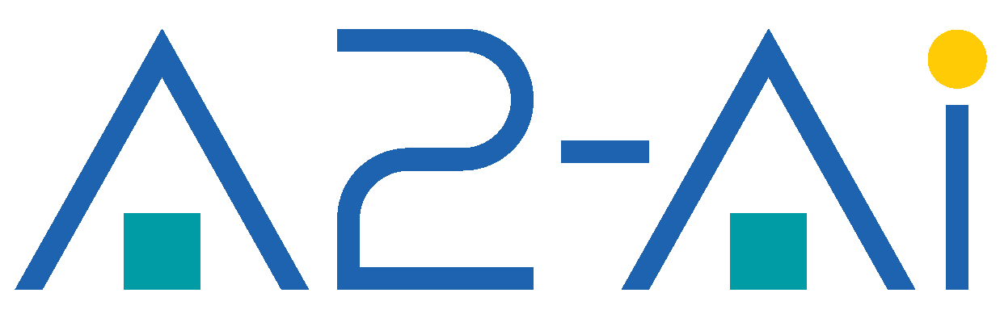

---
format:
  revealjs:
    theme: [default, splash.scss]
    embed-resources: true
    slide-number: false
    controls: true
    progress: true
    code-line-numbers: false
    transition: fade
    background-transition: fade
    center: true
    include-in-header:
      text: |
        <link rel="preconnect" href="https://fonts.googleapis.com">
        <link rel="preconnect" href="https://fonts.gstatic.com" crossorigin>
        <link href="https://fonts.googleapis.com/css2?family=Outfit:wght@300;400;500;600;700&family=Rubik:wght@300;400;500;600;700&display=swap" rel="stylesheet">
---

##  {.splash .nostretch}

{.splash-logo fig-align="center"}

::: {.splash-topic}
**dvs** &nbsp;·&nbsp; _pronounced "devious"_
:::

::: {.splash-name}
Mossa Merhi Reimert
:::

::: {.splash-title}
Sr. Scientific Software Engineer
:::

## What is dvs?

**dvs** is a data versioning system for R projects.

It stores large data files in a content-addressed **storage directory** (separate from your git repo) and tracks them through small, text-based **meta files** that live alongside your code.

::: {.fragment}
git tracks code · dvs tracks data
:::

## Why not just git?

| | git | dvs |
|---|---|---|
| Source code | [✓]{.yes} | n/a |
| Config files | [✓]{.yes} | n/a |
| Data files (MBs to GBs) | [✗]{.no} slow / bloats history | [✓]{.yes} |
| Reproducible restores | partial | [✓]{.yes} content-addressed |
| Team sharing | via remote | via shared mount |

## Agenda

| | Vignette |
|---|---|
| 1 | [**intro**](intro.html): what dvs is, the four verbs |
| 2 | [**intro-r**](intro-r.html): the R package in depth |
| 3 | [**intro-cli**](intro-cli.html): the CLI in depth |
| 4 | [**collab**](collab.html): sharing data across projects |
| 5 | [**internals**](intro-internals.html): `.dvs/` layout, blobs, audit log |
| 6 | [**config**](config.html) and [**audit**](audit.html): dvs.toml, compression, the audit log |

## How to read these

**R API** (`dvs_*` functions) and **CLI** (`dvs` binary) are equivalent. Choose whichever fits your workflow.

```r
dvs_add("data/file.csv", message = "v1")
```

```bash
dvs add data/file.csv -m "v1"
```

::: {.fragment}
**storage** = the blob directory (shared, not in git)

**project** = your R project (meta files committed, data files gitignored)
:::

## Where everything lives

[Start with the intro](intro.html), then the in-depth pages from the agenda.

Full reference, one page per function and command:

[a2-ai.github.io/dvs2-docs](https://a2-ai.github.io/dvs2-docs/)

Source: [github.com/A2-ai/dvs2](https://github.com/A2-ai/dvs2)
